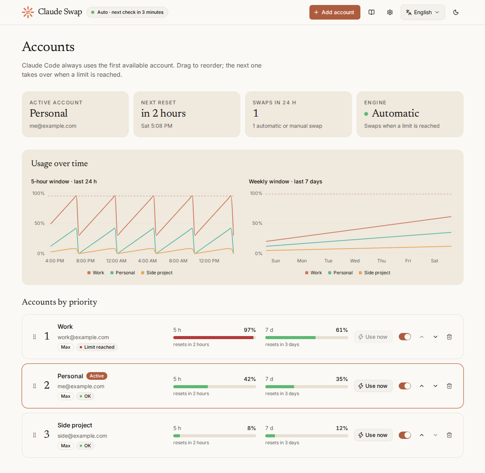
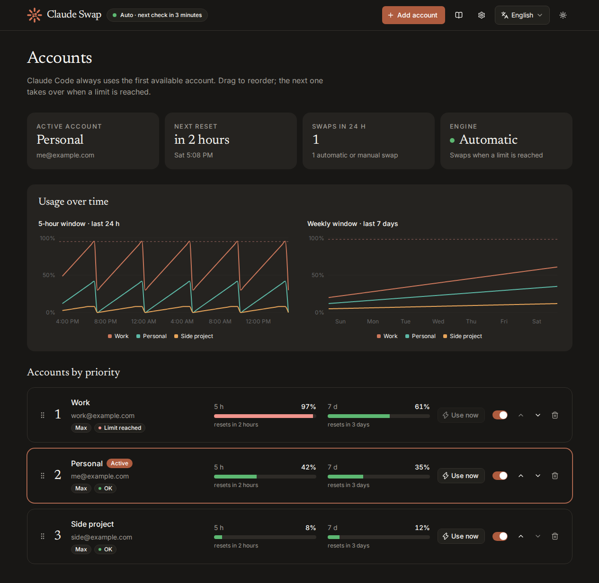

<div align="center">


<h1>Claude Swap</h1>

<hr width="160" />

<p>
  &nbsp;
  &nbsp;
  
</p>

<p>
  Keep <strong>Claude Code</strong> running on whichever of your Claude accounts still has room.<br />
  Local, private, and automatic: it swaps accounts when a limit is reached and swaps back when it resets.
</p>

</div>

---

## Why

If you have more than one Claude subscription (work and personal, say), you stop hitting a limit
in the middle of a session and then having to `/login` again by hand.

You add your accounts and put them in priority order. A small background service keeps exactly one
of them active in Claude Code and:

- **swaps down** to the next account when the active one reaches its **5-hour** or **weekly** limit;
- **swaps back up** to a higher-priority account as soon as its limit resets;
- lets you **swap by hand**: "Use now" (or dragging an account to the top) makes it active.

Everything runs on your machine: one Node process bound to `127.0.0.1`, JSON files for state, no
database, no telemetry. The web dashboard is optional; the engine works with no browser open. The
dashboard has built-in documentation (the book icon in the top bar) in every supported language.




## Requirements

- Linux with a systemd user session (to run it as a service; `npm run start` works anywhere on Linux)
- Node.js 24 or newer, npm
- Claude Code, logged in with file-based credentials (`~/.claude/.credentials.json`)

## Install

```sh
git clone <this repository> claude-swap
cd claude-swap
npm ci
npm run service:install
```

`service:install` builds the app, writes `~/.config/systemd/user/claude-swap.service` with the
absolute paths of your `node` binary and of this folder, then runs
`systemctl --user daemon-reload`, `enable` and `restart claude-swap.service`, so running it
again after `git pull` loads the new build. Open <http://127.0.0.1:4747>.

- Preview without changing anything: `node scripts/service.ts install --dry-run`.
- Logs: `journalctl --user -u claude-swap -f`.
- Status / restart: `systemctl --user status claude-swap`, `systemctl --user restart claude-swap`.
- To keep it running while you are logged out: `loginctl enable-linger $USER`.
- Remove the service: `npm run service:uninstall` (your accounts and settings are kept).

The unit points at the exact `node` binary you installed with. If you switch Node versions (nvm,
fnm, …) or move this folder, run `npm run service:install` again. After pulling new code, run it
again too (it rebuilds) or `npm run build && systemctl --user restart claude-swap`.

The built server (`dist/server/main.js`) bundles its npm dependencies, so the running service does
not need `node_modules`; building does.

npm 11 may warn that it did not run `esbuild`'s install script. This is harmless: the build uses the
prebuilt `@esbuild/linux-x64` package that npm installs anyway.

### Running without systemd

```sh
npm run build
npm run start                    # http://127.0.0.1:4747
node dist/server/main.js --port 5000 --open
```

| Flag / variable | Effect |
| --- | --- |
| `--port <n>` | Port to listen on (wins over `PORT`). Default `4747`. |
| `--open` | Open the dashboard in your browser (`xdg-open`) once listening. |
| `PORT` | Port when `--port` is not given. |
| `CLAUDE_SWAP_HOME` | Where claude-swap keeps its files (default below). |
| `CLAUDE_CONFIG_DIR` | Claude Code's config directory, same meaning as for Claude Code. |

## Adding accounts

1. In a terminal, run `claude`, then `/login` and sign in with the account you want to add.
2. In the dashboard, click **Add account**, optionally name it, and click **Import current login**.
3. Repeat for each account.

Switch accounts in Claude Code with `/login`, **never `/logout`**: logging out can revoke the
token claude-swap stored for that account. If an account's token stops working, the dashboard
marks it **needs re-login**; `/login` with it again and import it again.

If Claude Code is logged into an account claude-swap does not know, the dashboard shows a banner
and the engine stops swapping until you import that login (so it never overwrites a login you just
made).

## How swapping works

- The list order is the priority. The active account is the first one that is enabled, does not
  need a re-login, and has not reached a limit.
- An account has reached a limit when its 5-hour or weekly usage is at or above the threshold in
  Settings (95 % and 98 % by default) and that window has not reset yet.
- Every poll interval (3 minutes by default) the engine reads usage for each account, refreshes
  the tokens of inactive accounts before they expire, and picks the active account again.
- If every account is at a limit, it picks the one that frees up first.
- A swap writes the chosen account's login into Claude Code's files: `claudeAiOauth` in
  `.credentials.json` and `oauthAccount` in `.claude.json`. Every other key in both files is kept.
  Before claude-swap writes them the first time, it backs both files up.
- Before each swap, tokens Claude Code refreshed for the active account are saved back, so a
  rotated token is never lost.
- **Use now** moves an account to the top. Dragging (mouse or keyboard) or the up/down buttons
  change the order. Turning **Automatic** off in Settings keeps the top account active no matter
  what.

## Limitations

- **Running sessions**: a Claude Code session that is already open picks up the new account only
  when it reads its credentials file again (token refresh, or a rejected request). New sessions
  always use the active account. If a prompt hits the hard limit before the swap, Claude Code ends
  that turn; send `continue` in the same session once the swap is done. Thresholds below 100 %
  (the default) make the swap happen first.
- **Unofficial endpoints**: usage and token refresh use the same endpoints as Claude Code
  (`api.anthropic.com/api/oauth/usage`, `platform.claude.com/v1/oauth/token`). They are not a
  public API and may change without notice.
- **Linux only**: claude-swap reads and writes Claude Code's file-based credentials. macOS keeps
  them in the Keychain, which is not supported.
- One machine, one user: it manages the Claude Code login of the user running it.

## Files

claude-swap keeps its files in `$CLAUDE_SWAP_HOME`, else `$XDG_CONFIG_HOME/claude-swap`, else
`~/.config/claude-swap`. All are JSON with a `version` field, written atomically with mode `0600`.

| File | Contents |
| --- | --- |
| `config.json` | `preferences` (`theme`, `locale`, `autoRotate`, `thresholds.fiveHour`, `thresholds.sevenDay`, `pollIntervalSec`) and `accounts` (label, email, plan, enabled; array order = priority). Safe to read. |
| `secrets.json` | OAuth tokens per account. Never share it. |
| `state.json` | Latest usage per account, 7 days of usage history, last 200 activity entries. |
| `backups/` | Copies of Claude Code's `.credentials.json` and `.claude.json` taken before the first write. |

Claude Code's own files: `${CLAUDE_CONFIG_DIR:-~/.claude}/.credentials.json` and `~/.claude.json`
(or `$CLAUDE_CONFIG_DIR/.claude.json`).

Stop the service before editing these files by hand. A file that does not parse is renamed to
`*.corrupt-<time>` and replaced with defaults.

## Security

- The server listens on `127.0.0.1` only. It rejects requests whose `Host` is not
  `localhost`/`127.0.0.1` on its port (DNS rebinding) and cross-origin writes (CSRF).
- Tokens stay in `secrets.json` and Claude Code's credentials file. They are never sent to the
  browser and never logged; the logger also masks anything that looks like a token.
- The only outbound calls go to the two Anthropic endpoints above. No telemetry.
- The systemd unit adds the sandboxing a user service can use (`NoNewPrivileges`,
  `RestrictSUIDSGID`, `RestrictNamespaces`, `PrivateTmp`, `ProtectSystem=full`, …). Your home
  folder stays writable because the service has to write Claude Code's files. Anyone who can run
  code as your user can read your tokens, with or without claude-swap.

## Languages

The dashboard and its documentation are available in English, Español and Português (Brasil).
Pick one in the top bar or in Settings. Translations live in `src/web/i18n/messages/` and
`src/web/features/docs/content/`.

## Brand assets

The logo lives in `src/web/public/`: `logo.svg` (vector source), `favicon.ico` (16/32/48),
`favicon-16.png`, `favicon-32.png`, `apple-touch-icon.png` (180), `icon-192.png` and
`icon-512.png` (transparent background).

## Development

| Task | Command |
| --- | --- |
| Install | `npm ci` |
| Dev (API + Vite with HMR) | `npm run dev` |
| Production build / run | `npm run build && npm run start` |
| Lint / format check | `npm run lint` |
| Type check | `npm run typecheck` |
| Unit + integration tests | `npm test` |
| End-to-end tests | `npm run test:e2e` |
| Lint + types + tests | `npm run check` |
| Bundle size and idle memory budget (initial JS < 200 kB gzip, idle RSS < 100 MB) | `npm run perf:budget` |

Tests and `perf:budget` never touch your real `~/.claude`, `~/.claude.json` or
`~/.config/claude-swap`: they run the server with temporary `HOME`, `CLAUDE_SWAP_HOME` and
`CLAUDE_CONFIG_DIR` against a mock Anthropic API (`tests/e2e/mock-anthropic.ts`).

Design: [`docs/architecture.md`](docs/architecture.md). Visual language: [`DESIGN.md`](DESIGN.md).
Contributor and agent rules: [`AGENTS.md`](AGENTS.md).

## License

[MIT](LICENSE) © 2026 wesleyallan
